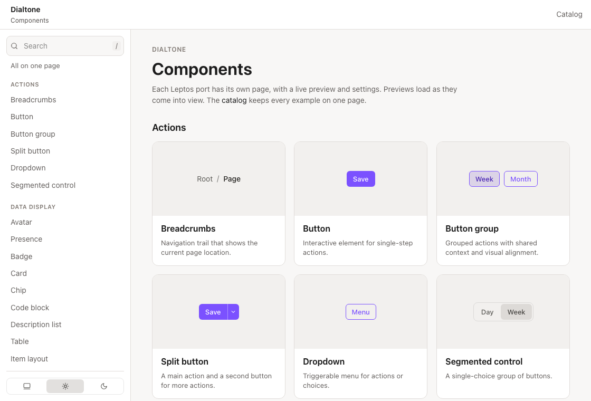

# dialtone-rust

Leptos ports of [Dialtone](https://dialtone.dialpad.com/), Dialpad's design system. The `dialtone` crate renders those components in a Rust wasm app and emits Dialtone class names. The app loads the CSS, tokens, and fonts from `dialtone/assets`.

`dialtone-demo` is the Trunk app for looking through the ports. Each component has a page with a live preview, settings, and the Rust call that drew it.

## Why use it

- A Leptos 0.8 view can call Dialpad's components directly. The crate is client-side.
- Dialtone CSS paints the class names the components emit. A button is `d-btn`, a card is `d-card`, and a modal is `d-modal`.
- Props follow the Vue components, written as `snake_case`. A controlled value is a signal. A slot is a view function.
- The demo is the place to check a port. Change its settings, then copy the call into your app.
- The set covers actions, data display, feedback, forms, and layout. The list is in [`dialtone/AGENTS.md`](dialtone/AGENTS.md).

## Quickstart

You need Rust, the `wasm32-unknown-unknown` target, and [Trunk](https://trunkrs.dev/). Install notes are in [`dialtone/README.md`](dialtone/README.md).

From the repository root:

```bash
cd dialtone-demo
trunk serve --port 8083 --address 127.0.0.1
```

Trunk compiles the demo and serves it at http://127.0.0.1:8083/. Open the component list:

http://127.0.0.1:8083/#/components



The sidebar is the full list. A card opens that component's page. The search box filters the list. Catalog keeps every example on one page: http://127.0.0.1:8083/#/catalog.

`dialtone-demo/Trunk.toml` listens on port 8082 when you run `trunk serve` with no port flag. This quickstart uses 8083. Trunk rebuilds when you edit the demo or the `dialtone` crate.

## Use it in a project

`dialtone` is private. It is not on crates.io. An app keeps a checkout of this repository and depends on the crate by path. A git dependency lands in Cargo's cache, and Trunk then has no stable path to `dialtone/assets`.

```bash
git clone git@github.com:nxndps/dialtone-rust.git
```

`gh repo clone nxndps/dialtone-rust` is the same checkout over HTTPS when `gh` can read the repository.

### Prerequisites

- Rust, edition 2021, and Cargo.
- `rustup target add wasm32-unknown-unknown`.
- Trunk, when the app is built the same way as `dialtone-demo`: `cargo install trunk`.
- Zig 0.13 or newer (`brew install zig`). Host proc-macros and build scripts link with Zig, so the build does not need Xcode or its command line tools. The wasm target still uses Rust's `rust-lld`.
- Leave `CARGO_TARGET_AARCH64_APPLE_DARWIN_LINKER` unset. The example config sets `SDKROOT=/`, which stops `rustc` from calling `xcrun`.

[`examples/hello-world`](examples/hello-world/README.md) is a working app. Its README is the checkout and build. From a fresh clone:

```bash
cd dialtone-rust/examples/hello-world
trunk serve --address 127.0.0.1
```

Open http://127.0.0.1:8084/. Run that command from `examples/hello-world`. Cargo reads `.cargo/config.toml` by walking up from the current directory, and that file points the host linker at `scripts/zig-cc`.

[`examples/hello-tauri`](examples/hello-tauri/README.md) is that page as a Tauri 2.12.5 app. The Trunk UI and the shell are both in that folder. Install the Tauri CLI once, then start the app from that directory:

```bash
cargo install tauri-cli --version "2.12.4" --locked
cd dialtone-rust/examples/hello-tauri
cargo tauri dev
```

`cargo tauri --version` prints `tauri-cli 2.12.4`. Run it from `examples/hello-tauri` so Cargo uses that folder's Zig linker. The shell still needs Xcode, because Tauri compiles Swift and links WebKit against the macOS SDK.

In your own app, next to the checkout:

```toml
[dependencies]
dialtone = { path = "../dialtone-rust/dialtone" }
leptos = { version = "0.8", features = ["csr"] }
getrandom = { version = "0.3", features = ["wasm_js"] }
```

Copy `tailwind.css`, the Trunk `copy-dir` links, `scripts/zig-cc`, and `.cargo/config.toml` from the example. Put `data-dt-mode` on `<html>`. Import the components. Do not add `mod dialtone` inside the app. The call-site rules are in [`dialtone/README.md`](dialtone/README.md).

## Developer lifecycle

`trunk serve` compiles the app before it serves the page. The first open waits on that compile. Leave the process running. After the app is built, Trunk watches the files in `Trunk.toml` and live-reloads the browser when one of them changes. You do not run a second serve command for those edits.

The demo watches `src`, `index.html`, `tailwind.css`, and `assets`. The hello-world example watches `src`, `index.html`, `tailwind.css`, and `favicon.svg`. `trunk build --release` is a one-shot compile and does not stay running to reload. `cargo tauri dev` in `examples/hello-tauri` runs Trunk in that folder on port 1420 and reloads the window when `src`, `index.html`, `tailwind.css`, or `favicon.svg` changes.
