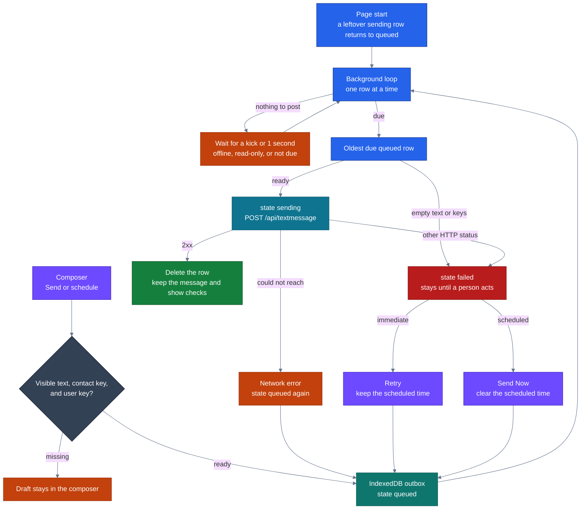
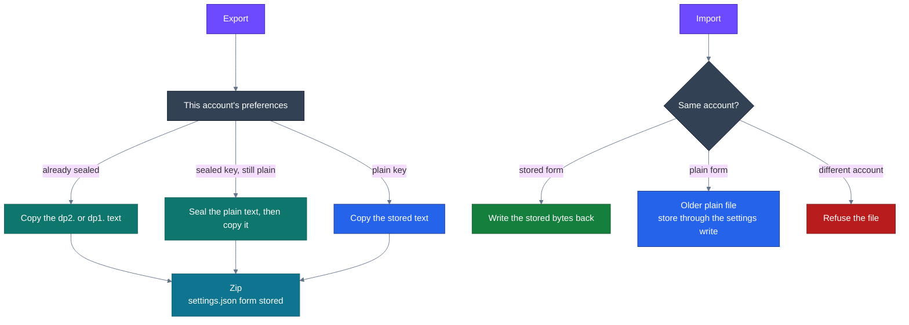

# dialtone-rust

## Debugging

`client-rust/dialpad-app/debugging` is a wasm crate of `#[wasm_bindgen]` functions for the DevTools console. It is a separate module from the app.

Build the glue from the repository root. `wasm-bindgen` on the CLI must be 0.2.129, the same release as the crate. Install it with `cargo install wasm-bindgen-cli --version 0.2.129` when the command is missing or reports a different version.

```bash
cargo build --manifest-path client-rust/Cargo.toml -p debugging --target wasm32-unknown-unknown
wasm-bindgen client-rust/target/wasm32-unknown-unknown/debug/debugging.wasm \
  --target web \
  --out-dir client-rust/dialpad-app/debugging/dist \
  --out-name debugging_crate
```

Restart `dialpad-app-server` after this build. It serves that directory at `/debugging/`. A Trunk rebuild of the app does not rebuild this crate.

Open http://dialpadbeta.com:8092/app in the local Chrome profile (`--user-data-dir="$HOME/chrome-dev-profile"` and `--host-resolver-rules="MAP dialpadbeta.com 127.0.0.1"`). Paste this into the DevTools console:

```javascript
const {
  default: init,
  listConfig,
  setDebug,
  setResponseLogging,
  setNavigationLogging,
  setPushLogging,
  setClickTracking,
  setConfig,
  getConfig,
} = await import('/debugging/debugging_crate.js');
await init();
window._dpdb = {
  listConfig,
  setDebug,
  setResponseLogging,
  setNavigationLogging,
  setPushLogging,
  setClickTracking,
  setConfig,
  getConfig,
};
window._dpdb.listConfig();
```

`window._dpdb.listConfig()` prints every `localStorage` item. Values sealed by the app are shown decrypted. The call does not write `localStorage`. The table columns are `key`, `policy`, and `value`. `policy` is `encrypted` or `plain`. A sealed value that cannot be opened is shown as `(could not open)`.

`window._dpdb.setDebug(true)` stores `dialpad-app:dbv`. `window._dpdb.setResponseLogging(true)`, `window._dpdb.setNavigationLogging(true)`, `window._dpdb.setPushLogging(true)`, and `window._dpdb.setClickTracking(true)` store the matching debug switches. Pass `false` to turn one off. Each writes `1` or `0`. The open page reads that write and updates the Debug checkboxes.

`window._dpdb.setConfig(key, value)` stores the plain string in `value`. A key that `storage.yaml` marks encrypted is sealed. A key marked plain is stored as that string. `window._dpdb.getConfig(key)` returns the opened string, or `undefined` when the key is absent.

The Preferences Debug tab shows when the page was opened with `?dbv=true` or when `dialpad-app:dbv` is already on. The address does not change the saved value. `setDebug` does.

## Message outbox

A conversation send is queued in IndexedDB. A background loop posts the oldest due row to `/api/textmessage`. The loop starts from `outbox::boot()` in `client-rust/dialpad-app/app/src/lib.rs`, after the offline listener is installed. The store is `offline_store.rs`. The composer is `ui/feed.rs`.

The database is `dialpad-app` version 4. The object store is `outbox`, keyed by `local_id`, with an index on `contact_key`. A row is schemaless JSON:

| Field | Meaning |
| --- | --- |
| `local_id` | `local:{milliseconds}:{counter}` |
| `contact_key` | Conversation the row belongs to |
| `target_key` | Signed-in user key. The post sends it as `sender_key`, `target_key`, and `feed_target` |
| `sender_name` | Display name captured when the row was queued. An empty name shows as `You` |
| `html` | Composer HTML. The post sends the plain text |
| `created_at_ms` | When the row was queued |
| `send_at_ms` | Unix milliseconds for a scheduled send. Omitted for an immediate send |
| `state` | `queued`, `sending`, or `failed` |

A row written before `send_at_ms`, `target_key`, and `sender_name` existed is an immediate queued send.

Send and the schedule menu both call `enqueue`. A blank message, an empty contact key, or an empty user key leaves the draft in the composer. A ready send writes the row as `queued`, clears the draft, and wakes the loop. Schedule stays available while the app is offline or read-only. Preset labels map onto local civil time: Today at 12:00 pm, Today at 3:00 pm, Tomorrow at 9:00 am, and Tomorrow at 12:00 pm. Custom time has to be at least 15 minutes ahead. The loop posts that same text-message endpoint when `send_at_ms` arrives.

Purple is a person. Teal is the store. Blue is the loop. Cyan is the post. Amber is a wait. Slate is the check before a row is stored. Green is an accepted send. Red is a row that needs a person.



The loop reads every outbox row and picks the oldest `queued` row whose `send_at_ms` is absent or already due. `sending` and `failed` rows wait. A future `send_at_ms` waits. Order is `created_at_ms`, then `local_id`.

Before the post, block breaks in the HTML become newlines and the tags are stripped. Empty plain text, an empty `target_key`, or an empty `contact_key` marks that row `failed` and the loop looks at the next row. The body is JSON: `feed_type` `TextMessage`, `orientation` `internal`, the user key, `contact_key`, plain `text`, `action` `new`, `client_id`, `feed_date` at post time, and `feed_key` set to `local_id`. The post uses the page session cookies.

A network error puts the row back to `queued` and records the outage. The loop then waits, so an offline client does not post in a tight loop. Any other HTTP status, including 401 and 403, marks the row `failed` and keeps `send_at_ms`. A failed row is not posted again until the conversation asks.

The open conversation shows the row as soon as it is queued and reloads it when the loop changes it. The status line is the sender name, the local time the row was queued, and the state:

- `Ada 1:14 pm Waiting to send ...` for an immediate row, and for a scheduled row whose time has arrived
- `Ada 1:14 pm Sending ...`
- `Ada 1:14 pm sending failed - retry` with a retry icon. Retry sets the row back to `queued` and keeps `send_at_ms`
- `Ada 1:14 pm Scheduled at Tomorrow at 9:00 am` while the scheduled time is still ahead
- `Ada 1:14 pm Scheduled at Tomorrow at 9:00 am failed - Send Now` with a send icon. Send Now sets the row back to `queued` and clears `send_at_ms`

The scheduled phrase is `Today at {time}`, `Tomorrow at {time}`, `{Weekday} at {time}` for two to six days ahead, `{Month} {D} at {time}` inside a year, and `{M}/{D}/{YYYY} at {time}` after that.

A 2xx response deletes the outbox row and stores the accepted message in the `conversations` store. The open thread shows it beside the feed until that key is already in the loaded list. A sent message of yours shows the name, the local time, one check, and a second check. The second check stays muted until `last_delivery_status` is `delivered`.

`kick()` wakes the loop after a queue write, a retry, Send Now, and a browser `online` event when the app is not read-only. Manual offline stays read-only. The one-second timer is the fallback. On the next page load, `recover_outbox` moves a row left in `sending` back to `queued` before the loop starts.

The response log stores `{"action":"new"}` and the HTTP status. The console line is `outbox_send {state}` or `outbox_send {state} {status}`. The message text stays out of that log.

## Settings export

Preferences → Debug → Settings and data writes a zip for the signed-in account and can read one back. The control is Settings only or All information. The code is `client-rust/dialpad-app/app/src/account_bundle.rs`. The download names are `dialpad-settings.zip` and `dialpad-account-data.zip`. The account id is not in the file name.

A sealed preference is copied as the text already in localStorage. That text starts with `dp2.` (the current AES-GCM seal) or `dp1.` (the older seal). The export does not open it, so the zip holds the ciphertext. Import writes those same bytes back. A value that should be sealed and is still plain text is sealed before it goes into the file. A plain preference, such as appearance or a page size, is copied as its stored text.

The access token, the account document, the API host, the browser id, recaptcha, the version-refresh stamp, and the scope-owner marker stay out of the file. Another account's keys stay out. The manifest records this account's id, and import refuses a different account. The id is not shown and is not logged.

Settings only is `manifest.json` and `settings.json`. All information also includes one JSON file per IndexedDB table (`console-logs`, `lists`, `responses`, `contacts`, `channels`, `conversations`, `drafts`, `outbox`) and the uploaded files from `dialpad-uploads-{id}`. `dialpad-assets` stays out. Those tables and files are the stored records. They are not sealed.

`settings.json` has `"form": "stored"` and one row per preference. The row's `key` is the base name, such as `dialpad-app:log-level`. The row's `value` is the stored text. An older file with no `form`, or `"form": "plain"`, holds opened text. Import of that older file stores it through the normal settings write, which seals a key that `storage.yaml` marks encrypted.

Import replaces this account's preferences with the rows in the file. A settings file imported as All information does not clear IndexedDB. A full file replaces the listed tables and the upload store, then the preferences. After a successful import the page reloads. A canceled file dialog does nothing. The zip is stored, not deflated, so a Finder re-zip does not import.

Purple is the person. Teal is the sealed preference. Blue is the plain preference. Cyan is the zip. Green is a write back into this account. Red is a file that is refused. Slate is the account check.


